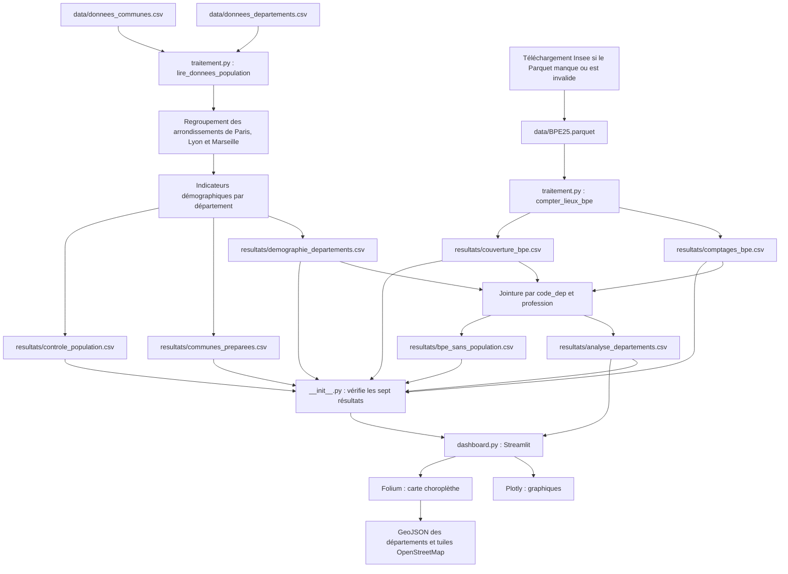

# SantéScope

SantéScope est un tableau de bord Streamlit qui explore les liens entre la
concentration de la population communale et l'offre de soins observée dans les
départements français. Le traitement utilise les populations légales de l'Insee
2023 et la Base permanente des équipements (BPE) 2025.

## Fonctionnalités disponibles

- Indicateurs démographiques par département calculés à partir des communes.
- Comptage BPE pour quatre professions : médecins généralistes,
  chirurgiens-dentistes, kinésithérapeutes et infirmiers.
- Densités calculées en lieux BPE pour 100 000 habitants.
- Tableau de bord filtrable par région et profession, avec une sélection de
  département à mettre en évidence.
- Carte Folium des contours départementaux, couvrant la métropole et
  l'outre-mer, avec une légende de densité.
- Graphiques de distribution et relation statistique, dont la corrélation de
  Spearman avec et sans Paris.
- Export CSV du tableau affiché.

Les données APL de la DREES ne sont pas intégrées. Le tableau de bord ne simule
pas ces valeurs.

## Structure du projet

```text
.
├── data/
│   ├── donnees_communes.csv
│   ├── donnees_departements.csv
│   └── BPE25.parquet             # téléchargé automatiquement si absent
├── resultats/                    # sept CSV générés par traitement.py
├── config.toml                   # fichier présent à la racine du projet
├── dashboard.py                  # application Streamlit
├── traitement.py                 # préparation, jointures et contrôles
├── __init__.py                   # lanceur : préparation si nécessaire, puis dashboard
├── requirements.txt
├── .gitignore
└── README.md
```

Les dossiers locaux `.venv/` et `__pycache__/` peuvent aussi apparaître après
l'installation et l'exécution ; ils ne contiennent pas de sources du projet et
sont ignorés par Git.

Les codes département et commune sont conservés comme chaînes afin de préserver
les zéros initiaux et les codes tels que `2A` et `2B`.

## Flux réel des données



Le fonctionnement normal commence par `__init__.py`. Il lance l'ensemble du
pipeline si au moins un des sept résultats attendus manque ; sinon, il conserve
les résultats présents et démarre directement le dashboard. Le pipeline complet
lit les deux CSV Insee, télécharge et traite la BPE si nécessaire, puis réalise
les jointures et contrôles avant d'écrire les fichiers dans `resultats/`.

Le dashboard ne relit pas les CSV sources : il charge
`resultats/analyse_departements.csv`. La carte récupère les contours GeoJSON à
la demande ; il n'existe pas de dossier local `data/geo/` dans la structure
actuelle. Le cache Streamlit évite de recharger les données analytiques à chaque
interaction.

## Prérequis et installation

Python 3.11 ou plus récent est recommandé. Depuis la racine du projet, crée un
environnement virtuel et installe les dépendances.

### Windows PowerShell

```powershell
py -3 -m venv .venv
.\.venv\Scripts\Activate.ps1
python -m pip install --upgrade pip
python -m pip install -r requirements.txt
```

### Linux ou macOS

Si Python 3 n'est pas installé sur Debian ou Ubuntu :

```bash
sudo apt update
sudo apt install python3 python3-venv
```

Puis, depuis la racine du projet :

```bash
python3 -m venv .venv
source .venv/bin/activate
python -m pip install --upgrade pip
python -m pip install -r requirements.txt
```

L'environnement virtuel doit rester activé pendant le traitement et le
lancement du tableau de bord. Cela garantit que Streamlit et Folium utilisent
les dépendances installées dans le même environnement.

## Données d'entrée

Les deux fichiers CSV suivants sont lus par le traitement :

| Fichier | Contenu | Format |
|---|---|---|
| `data/donnees_departements.csv` | Référentiel départemental et populations légales 2023 | UTF-8, séparateur `;` |
| `data/donnees_communes.csv` | Populations légales communales 2023 | UTF-8, séparateur `;` |

Sources utilisées :

- [Populations légales Insee 2023](https://www.insee.fr/fr/statistiques/8680726)
  pour les deux fichiers CSV ci-dessus.
- [Base permanente des équipements de l'Insee](https://www.insee.fr/fr/metadonnees/source/serie/s1161),
  millésime 2025. Le fichier `data/BPE25.parquet` est téléchargé depuis
  [l'URL du fichier BPE25](https://www.insee.fr/fr/statistiques/fichier/8217525/BPE25.parquet)
  par [`traitement.py`](./traitement.py) lorsqu'il est absent ou invalide.
- [Contours GeoJSON des départements](https://github.com/gregoiredavid/france-geojson/blob/master/departements-avec-outre-mer.geojson),
  récupérés par le dashboard pour la carte.
- [OpenStreetMap](https://www.openstreetmap.org/copyright) pour le fond de carte.

Une connexion Internet est nécessaire pour télécharger le fichier BPE si besoin,
ainsi que pour afficher les contours GeoJSON et les tuiles OpenStreetMap.

La source communale fournie contient 100 départements et ne comprend pas
Mayotte. Les lieux BPE des territoires sans population correspondante sont
signalés dans les résultats, au lieu d'être fusionnés silencieusement.

## Lancer tout le projet

Après l'installation, la commande normale pour tout lancer est :

```bash
python __init__.py
```

Lance cette commande depuis la racine du projet, avec l'environnement virtuel
activé. Le script `__init__.py` vérifie les sept fichiers attendus dans
`resultats/` :

- si un ou plusieurs résultats manquent, il exécute tout le traitement ;
- sinon, il réutilise les résultats déjà présents ;
- puis il lance le dashboard Streamlit.

Le traitement lit les populations départementales et communales, regroupe les
arrondissements municipaux de Paris, Lyon et Marseille, vérifie les populations
et nombres de communes, compte les lieux BPE par département et profession,
puis calcule les densités.

Il s'arrête explicitement en cas de codes de profession attendus absents, de
doublons ou d'écarts dans les contrôles de population et de communes.

### Recalculer les données manuellement

Après une modification des fichiers d'entrée, ou pour forcer un recalcul, lance
le traitement puis le lanceur principal :

```bash
python traitement.py
python __init__.py
```

### Fichiers produits

Les résultats sont écrits dans `resultats/` :

| Fichier | Contenu |
|---|---|
| `controle_population.csv` | Comparaison des populations et nombres de communes |
| `communes_preparees.csv` | Données communales après regroupement des arrondissements municipaux |
| `demographie_departements.csv` | Population et indicateurs démographiques départementaux |
| `comptages_bpe.csv` | Nombre de lieux BPE par département et profession |
| `couverture_bpe.csv` | Départements présents dans la BPE |
| `bpe_sans_population.csv` | Comptages BPE sans département correspondant dans les données de population |
| `analyse_departements.csv` | Table finale utilisée par le tableau de bord |

Streamlit affiche l'adresse locale, habituellement `http://localhost:8501`.

## Utiliser le tableau de bord

La barre latérale permet d'appliquer les filtres de région et de profession et
de mettre un département en évidence. Les onglets disponibles sont :

- **Vue d'ensemble** : indicateurs clés et aperçu de l'offre.
- **Population** : concentration et répartition de la population entre les
  communes.
- **Offre de soins** : carte départementale, densités et comparaison des
  professions.
- **Relations** : association de Spearman entre concentration démographique et
  densité, avec une comparaison hors Paris.
- **Données** : tableau filtré et export CSV.

La carte colore les contours selon la densité de la profession sélectionnée :
clair signifie densité faible, foncé densité élevée, gris signifie valeur
indisponible. Le contour ambre met en évidence le département choisi. Un seul
zoom couvre la métropole et l'outre-mer ; il peut donc être très éloigné pour
afficher l'ensemble du territoire.

## Interprétation et limites

- La BPE compte des **lieux d'exercice**, pas nécessairement des praticiens
  uniques.
- Une densité départementale ne décrit pas les distances ni les temps d'accès
  aux soins.
- Les corrélations affichées sont descriptives et ne démontrent pas de causalité.
- Les millésimes utilisés diffèrent : population 2023 et BPE 2025.
- Mayotte est absente des données de population fournies ; les résultats BPE
  sans correspondance sont conservés dans un fichier de contrôle.
