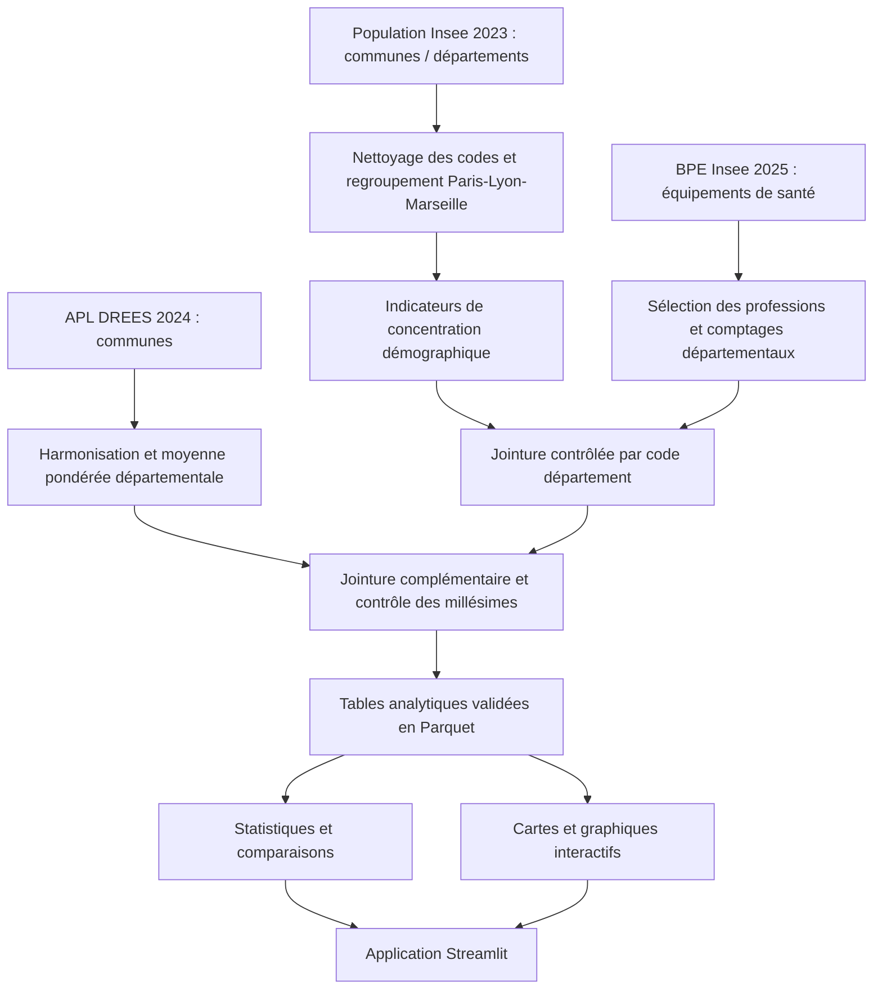

<div align="center">

# 🩺 SantéScope

### Population, territoires et inégalités d'offre de soins en France

**Projet Streamlit · BUT 3 Science des Données · Parcours VCOD · 2026**


*Des données publiques pour mieux comprendre les disparités territoriales de santé.*

**[Problématique](#-1-problématique-et-objectifs) · [Sources](#-2-sources-de-données) · [Équipe](#-4-organisation-du-travail-à-quatre) · [Installation](#-6-installation-et-lancement) · [Dashboard](#-9-dashboard-streamlit) · [Qualité](#-11-tests-et-critères-de-validation)**

</div>

---

> **État du projet : en développement.** Ce README constitue la spécification de travail de l'équipe. Les étapes, pages ou fonctionnalités décrites comme prévues ne sont pas présentées comme déjà implémentées. Date de soutenance : **30 novembre 2026** ; dépôt sur **Updago avant la soutenance**.

## 🎯 1. Problématique et objectifs

### Problématique retenue

> **Dans quelle mesure la répartition géographique de la population est-elle associée aux inégalités d'offre de soins entre les départements français ?**

Nous cherchons à déterminer si les départements dont la population est concentrée dans quelques communes présentent des caractéristiques d'offre et d'accessibilité aux soins différentes de celles des départements dont la population est plus dispersée.

**Question scientifique :** nous étudions des **associations statistiques**, pas des relations de causalité. Le verbe « influencer » ne pourra être employé comme conclusion causale sur la seule base de ces données transversales.

### Quatre axes de recherche

| Axe | Question | Résultat attendu |
|---|---|---|
| **A1. Démographie** | La population est-elle concentrée dans quelques communes ou dispersée ? | Indice de concentration, part de population des communes dominantes, comparaisons régionales |
| **A2. Offre de soins** | Quels départements disposent de davantage de lieux d'exercice rapportés à leur population ? | Densités BPE par profession, carte et classements |
| **A3. Accessibilité** | Une densité élevée implique-t-elle nécessairement une bonne accessibilité ? | Confrontation **BPE** / **APL DREES**, étude des écarts |
| **A4. Relations territoriales** | La concentration démographique est-elle associée à l'offre ou à l'APL ? | Nuages de points, coefficients de corrélation, comparaison de profils |

### Hypothèses à tester, non présumées vraies

- **H1** — Les départements dont la population est plus concentrée ont des densités de lieux d'exercice différentes des départements moins concentrés.
- **H2** — La densité départementale BPE et l'accessibilité potentielle localisée (APL) ne classent pas nécessairement les départements de la même façon.
- **H3** — La relation entre concentration démographique et accès aux soins dépend de la profession étudiée.

### Périmètre

- **Échelle de restitution :** département ; **échelle de préparation :** commune/arrondissement municipal lorsque nécessaire.
- **Population :** Insee, référence **2023** ; **offre de soins :** BPE **2025** ; **accessibilité :** DREES-APL **2024**.
- **Champ géographique initial :** les **100 départements présents dans le fichier Insee fourni**, soit 96 départements métropolitains et quatre départements ultramarins. **Mayotte (976) n'y figure pas.** Toute réduction ultérieure du champ après jointure sera mesurée et documentée.
- **Professions du noyau de l'analyse :** médecins généralistes, infirmiers, masseurs-kinésithérapeutes, chirurgiens-dentistes. Les autres professions de la BPE sont envisageables en extension, mais ne disposent pas toutes d'APL comparable.

---

## 🗃️ 2. Sources de données

### 2.1 Sources principales — à utiliser obligatoirement dans le projet

| Source | Producteur / millésime | Granularité | Variables ou usages | Accès |
|---|---|---|---|---|
| **Populations de référence** | Insee **2023** | Commune, département, région | `DEP`, `REG`, `COM`, `PMUN`, `NBCOM` ; poids démographique et concentration | [Fichier d'ensemble Insee](https://www.insee.fr/fr/statistiques/8680726) |
| **Base permanente des équipements (BPE)** | Insee **2025** | Équipement individuel, commune / département | `DEP`, `TYPEQU` ; lieux d'exercice des professions de santé | [Présentation officielle de la BPE](https://www.insee.fr/fr/metadonnees/source/serie/s1161) |
| **Contours départementaux** | France-GeoJSON / référentiel administratif | Département | Polygones et codes pour la carte choroplèthe ; **ne compte pas comme source statistique distincte** | [France-GeoJSON](https://github.com/gregoiredavid/france-geojson/blob/master/departements-avec-outre-mer.geojson) |

**Règle impérative du sujet :** croiser **au moins deux sources statistiques indépendantes** par une jointure, sans compter le référentiel cartographique. Le couple **BPE + population Insee** remplit cette exigence ; deux tableaux extraits du même fichier des populations ne doivent pas être présentés comme deux sources indépendantes.

### 2.2 Enrichissement principal retenu — DREES-APL

| Source | Producteur / millésime | Granularité | Usage | Accès |
|---|---|---|---|---|
| **Accessibilité potentielle localisée (APL)** | DREES **2024** | Commune, par profession | Mesurer l'accessibilité en intégrant l'offre proche, la distance, l'activité et les besoins liés à l'âge | [Données APL DREES](https://data.drees.solidarites-sante.gouv.fr/explore/dataset/530_l-accessibilite-potentielle-localisee-apl/) |

Pour les généralistes, l'APL représente des **consultations accessibles par habitant standardisé** ; pour plusieurs autres professions, elle est exprimée en **équivalents temps plein pour 100 000 habitants standardisés**. **Ces unités ne doivent pas être additionnées ni présentées comme les mêmes unités que les densités BPE.**

**Méthode retenue :** travailler avec les valeurs APL communales, puis calculer pour chaque département une **moyenne pondérée par la population municipale des communes appariées** (en indiquant la couverture des communes et des habitants), ou utiliser un agrégat départemental officiel s'il est disponible et compatible. Le fichier APL téléchargé devra être examiné avant de fixer les noms de colonnes et la méthode de correspondance des codes communaux.

### 2.3 Sources du § 2.2 non retenues dans le cœur du projet

| Source | Décision | Justification |
|---|---|---|
| **Pathologies par département — Cnam** | *Extension possible* | Permet de contextualiser les besoins (diabète, maladies chroniques), mais élargit les analyses et impose de respecter les définitions propres à la Cnam. [Source](https://data.ameli.fr/explore/assets/effectifs/) |
| **FINESS — ANS** | *Extension possible* | Mesure les structures de soins ; distinct des lieux d'exercice libéral. Pour 2026, utiliser les nouveaux flux [FINESS Structures](https://www.data.gouv.fr/datasets/finess-structures-1) si besoin. |
| **Annuaire Santé / RPPS — ANS** | *Non prioritaire* | Risque de doublonner des informations présentes dans la BPE et complexifie l'harmonisation. |
| **SAE — DREES** | *Non prioritaire* | Données utiles sur les établissements hospitaliers, hors du périmètre initial des soins de ville. |

**Principe :** trois sources statistiques bien intégrées valent mieux qu'une accumulation de cinq sources difficilement comparables.

### 2.4 Inventaire des fichiers de population déjà transmis au groupe

Les fichiers ci-dessous proviennent de l'ensemble Insee de référence 2023, au format CSV **UTF-8**, séparateur **`;`**.

| Fichier | Lignes observées / rôle |
|---|---|
| `donnees_departements.csv` | **100** départements ; table de référence pour les populations départementales |
| `donnees_communes.csv` | **34 900** lignes ; concentration et dispersion de la population à partir des unités communales diffusées |
| `donnees_regions.csv` | **17** régions ; libellés et regroupements régionaux |
| `donnees_arrondissements.csv` | Référentiel de contrôle supplémentaire ; non nécessaire au MVP |
| `donnees_cantons.csv` | Non nécessaire au MVP |
| `donnees_collectivites.csv` | Collectivités à champ distinct ; ne pas intégrer automatiquement au niveau départemental |
| `donnees_communes_deleguees.csv` | Risque de double comptage avec le fichier communal ; non nécessaire au MVP |
| `donnees_fractions_cantonales.csv` | Non nécessaire au MVP |
| `metadonnees.csv` | Dictionnaire des variables et modalités |

**Contrôle initial déjà réalisé sur les trois fichiers majeurs :** `PMUN` totalise **68 094 280 habitants** dans `donnees_departements.csv`, `donnees_communes.csv` et `donnees_regions.csv`. Ce total devra encore être vérifié dans le pipeline, sans mélanger les niveaux géographiques.

**Contrôle communal complémentaire :** après regroupement des arrondissements municipaux, les **34 900 lignes** deviennent **34 858 communes**. Le nombre de communes obtenu est cohérent avec `NBCOM` pour chacun des 100 départements.

**Point technique capital :** les fichiers communaux détaillent **Paris (20 arrondissements municipaux), Lyon (9) et Marseille (16)**. Pour les calculs de concentration **par commune**, nous devons **réagréger ces unités en trois communes** (`75056`, `69123`, `13055`), sans doubler leur population. Pour cartographier ou joindre la BPE à l'échelle fine, les arrondissements d'origine peuvent être conservés dans une table distincte. Les indicateurs communaux et infra-communaux ne doivent pas être mélangés.

---

## 🧭 3. Méthodologie et indicateurs

### 3.1 Définitions et formules

| Indicateur | Calcul / définition | Interprétation |
|---|---|---|
| **Population (`PMUN`)** | Population municipale Insee 2023 | Dénominateur des densités |
| **Densité BPE** | `(nombre de lieux d'exercice / PMUN départementale) × 100 000` | Lieux d'exercice pour 100 000 habitants ; **pas** nombre de praticiens uniques |
| **Part de la plus grande commune** | `population de la commune la plus peuplée / population départementale` | Concentration dans une seule commune |
| **Concentration des 10 % de communes les plus peuplées** | `somme PMUN des ceil(10 % des communes) les plus peuplées / PMUN départementale` | Concentration interne, entre 0 et 1 |
| **Part de petites communes** | `nombre de communes avec PMUN < 500 / nombre de communes` | Morcellement démographique, **pas** preuve de ruralité |
| **APL départementale** | Moyenne de l'APL communale pondérée par la population des communes appariées | Accessibilité potentielle selon la profession, avec **unité propre** |
| **Corrélation** | Coefficient de Spearman (principal) ; Pearson (complément) | Association entre concentration et densité ou APL |

L'étude portera sur les **associations entre indicateurs**. La conclusion tiendra compte des facteurs non observés : structure par âge, besoins de santé, mobilité, densité physique du territoire, temps de trajet, activité des praticiens, effets des départements atypiques.

**Analyse de sensibilité obligatoire :** recalculer les corrélations en retirant au moins **Paris**, puis comparer avec l'échantillon complet. Paris est un cas structurellement particulier pour la concentration communale.

### 3.2 Règles de qualité et de traitement

1. Conserver tous les codes administratifs comme **chaînes de caractères**, jamais comme entiers : `01`, `2A`, `2B`, `971`…
2. Convertir `PMUN`, `PTOT`, `NBCOM` en nombres après vérification des valeurs non numériques ; utiliser **PMUN** comme référence principale.
3. Conserver les sources téléchargées **inchangées** dans `data/raw/` ; produire des tables dérivées dans `data/processed/`.
4. Réagréger les arrondissements de Paris, Lyon et Marseille **uniquement pour l'indicateur communal** ; contrôler la conservation du total de population.
5. Harmoniser les codes départementaux et communaux entre 2023, 2024 et 2025. Les fusions de communes et changements de géographie doivent apparaître dans un **rapport des clés non appariées**, pas être corrigés silencieusement.
6. Agréger les équipements BPE **par département et par profession** avant de joindre la population. Éviter une jointure équipement × commune produisant des duplications non contrôlées.
7. Faire les jointures avec `validate=` et `indicator=` ; mesurer les lignes avant/après, les clés non appariées et la couverture de population.
8. Ne pas traiter un APL manquant comme zéro. Ne transformer un comptage BPE manquant en zéro que lorsque l'absence d'équipement est confirmée sur un territoire couvert.
9. Vérifier la compatibilité entre les codes des cartes GeoJSON et la géographie 2023–2025.
10. Ne jamais comparer directement un **nombre de lieux BPE** à un **nombre d'ETP ou de consultations APL** : ce sont des indicateurs de nature différente.

### 3.3 Flux de traitement



### 3.4 Contrats de données partagés (à valider avant le développement UI)

| Table produite | Granularité | Clé logique | Principales colonnes attendues |
|---|---|---|---|
| `population_departements.parquet` | 1 ligne / département | `code_dep` unique | `nom_dep`, `code_reg`, `nom_reg`, `population_2023`, `nb_communes` |
| `concentration_departements.parquet` | 1 ligne / département | `code_dep` unique | `part_plus_grande_commune`, `part_top_10pct_communes`, `part_petites_communes` |
| `offre_departements.parquet` | 1 ligne / département / profession | (`code_dep`, `profession`) unique | `nb_lieux`, `densite_100k` |
| `apl_departements.parquet` | 1 ligne / département / profession APL | (`code_dep`, `profession`) unique | `apl_2024`, `unite_apl`, `couverture_pop_pct` |
| `analyse_departements.parquet` | 1 ligne / département / profession | (`code_dep`, `profession`) unique | Population, concentration, offre, APL (si disponible), indicateurs utilisés par les pages |
| `rapport_qualite.csv` | 1 ligne / contrôle | `controle` | Métrique, attendu, observé, résultat, remarques |

Ces fichiers décrivent le **contrat cible**. Les noms et colonnes des fichiers BPE et APL bruts seront fixés après leur téléchargement et l'inspection des données.

---

## 👥 4. Organisation du travail à quatre

### Équipe

| Membre | Responsabilité principale | Contribution transverse |
|---|---|---|
| **Personne A — Imane** | Acquisition, nettoyage et intégration **Insee Population + BPE** | Audit des jointures, documentation des sources |
| **Personne B — Quentin** | Intégration **DREES-APL**, indicateurs et analyses statistiques | Interprétation des résultats et limites |
| **Personne C — Deonna** | Cartographie, visualisations, design et expérience utilisateur | Contrôle du GeoJSON et du rendu graphique |
| **Personne D —  Alexan** | Architecture Streamlit, interactions, intégration, packaging | Tests transversaux, CI et reproductibilité |

**Principe d'équité :** chaque membre développe un bloc identifiable, réalise ses propres tests, participe à l'intégration et prépare sa partie de l'oral. Le PowerPoint, le README final et la répétition sont des **responsabilités collectives**.

### Personne A — responsable des données Insee et des jointures initiales

**Fichiers pilotés :** `src/data/population.py`, `src/data/bpe.py`, `src/data/jointures.py`, `scripts/preparer_donnees.py`, `docs/sources.md`.

- [ ] Inventorier les CSV et leurs colonnes, types, tailles et millésimes.
- [ ] Télécharger le fichier BPE 2025 et la nomenclature des types de santé.
- [ ] Normaliser les codes département (`01`, `2A`, `2B`, outre-mer) et les types numériques.
- [ ] Calculer les indicateurs de concentration communale ; traiter Paris/Lyon/Marseille.
- [ ] Extraire les lieux d'exercice BPE des quatre professions retenues.
- [ ] Agréger la BPE par département et profession.
- [ ] Réaliser la jointure avec les populations (avec `validate` et `indicator`).
- [ ] Contrôler le nombre de lignes, les totaux, les doublons et les clés sans correspondance.
- [ ] Exporter les tables Parquet et un rapport de qualité.
- [ ] Rédiger les explications de source, de nettoyage et de jointure pour l'oral.

**Critère d'acceptation A :** deux tables documentées, `concentration_departements.parquet` et `offre_departements.parquet`, plus un rapport indiquant les écarts et les codes non appariés ; total `PMUN` cohérent avec les fichiers de référence.

### Personne B — responsable APL et de l'analyse statistique

**Fichiers pilotés :** `src/data/apl.py`, `src/analysis/indicateurs.py`, `src/analysis/statistiques.py`, `docs/methodologie.md`.

- [ ] Télécharger l'APL DREES 2024 et lire la documentation méthodologique.
- [ ] Identifier les professions, les unités et les codes communaux du fichier APL.
- [ ] Harmoniser les codes des communes entre les sources 2023 et 2024.
- [ ] Calculer les APL départementales pondérées et le taux de couverture correspondant.
- [ ] Calculer les densités, classements et dispersions statistiques.
- [ ] Calculer Spearman et Pearson (si pertinent), interpréter les résultats.
- [ ] Effectuer l'analyse de sensibilité avec et sans Paris.
- [ ] Préparer les éléments chiffrés et la conclusion, sans inventer de résultats.
- [ ] Tester les formules sur des petits cas connus.

**Critère d'acceptation B :** table `apl_departements.parquet`, fonctions d'analyse documentées, résultats reproductibles, tableau de limites et taux de couverture.

### Personne C — responsable des graphiques et du design

**Fichiers pilotés :** `src/viz/cartes.py`, `src/viz/graphiques.py`, `src/viz/theme.py`, `data/geo/`, `.streamlit/config.toml` (en coordination avec D).

- [ ] Télécharger et valider les contours GeoJSON.
- [ ] Vérifier la correspondance des codes département avec les données.
- [ ] Produire les cartes choroplèthes (concentration, densité BPE, APL).
- [ ] Produire les graphiques : nuages de points, classements, boîtes à moustaches, comparaisons.
- [ ] Utiliser une palette cohérente, accessible et lisible au vidéoprojecteur.
- [ ] Afficher unités, millésimes et périmètre dans titres/infobulles.
- [ ] Gérer les valeurs manquantes et la représentation de l'outre-mer.
- [ ] Tester la lisibilité sur écran large et petit écran.
- [ ] Fournir à D des fonctions `fig = ...` prêtes à intégrer dans Streamlit.

**Critère d'acceptation C :** une fonction par graphique, sans valeurs fictives, avec légendes correctes et comportement vérifié sous plusieurs filtres.

### Personne D — responsable de l'application et de l'intégration

**Fichiers pilotés :** `app.py`, `src/ui/`, `requirements.txt`, `.gitignore`, workflows de tests (avec l'équipe).

- [ ] Créer l'architecture Streamlit et la navigation.
- [ ] Définir et intégrer les pages du dashboard.
- [ ] Implémenter `st.form` pour appliquer ensemble les filtres.
- [ ] Implémenter `st.session_state` pour conserver les choix appliqués.
- [ ] Implémenter `st.cache_data` pour charger les fichiers préparés sans recalcul à chaque clic.
- [ ] Brancher les fonctions des personnes A, B et C sans recopier leur logique.
- [ ] Prévoir les états « données absentes », « filtre sans résultat » et « erreur contrôlée ».
- [ ] Ajouter un export CSV des résultats filtrés si le temps le permet.
- [ ] Tester la navigation, les filtres, la mise à jour des graphiques et le lancement sur une autre machine.
- [ ] Préparer une version ZIP prête à déposer, avec le groupe.

**Critère d'acceptation D :** application démarrant avec `streamlit run app.py`, pages intégrées, fonctionnalités avancées justifiées et procédure d'installation reproductible.

### Relectures croisées

| Code produit par | Relu par | Contrôle principal |
|---|---|---|
| A | B | Formules de préparation, jointures et conservation des totaux |
| B | A | Définition de l'APL, identifiants et couverture géographique |
| C | D | Interface des fonctions graphiques et intégration |
| D | C | Ergonomie, filtres et qualité des écrans |

**Règle collective :** aucun membre ne présente une fonction qu'il ne peut pas expliquer ; chacun doit aussi savoir décrire les fichiers des trois autres membres.

---

## 🏗️ 5. Architecture du dépôt

```text
SanteScope/
├── .streamlit/
│   └── config.toml                  # Thème et options UI
├── data/
│   ├── raw/                         # Sources officielles inchangées (non versionnées si lourdes)
│   ├── processed/                   # Tables préparées Parquet
│   └── geo/                         # GeoJSON des départements
├── docs/
│   ├── sources.md                   # URLs, millésimes, licences, noms de fichiers
│   ├── methodologie.md              # Indicateurs, jointures, limites
│   └── dictionnaire_donnees.md      # Schéma des tables produites
├── scripts/
│   └── preparer_donnees.py          # Préparation contrôlée, lancée une fois
├── src/
│   ├── __init__.py
│   ├── data/
│   │   ├── __init__.py
│   │   ├── population.py            # Personne A
│   │   ├── bpe.py                   # Personne A
│   │   ├── jointures.py             # Personne A
│   │   └── apl.py                   # Personne B
│   ├── analysis/
│   │   ├── __init__.py
│   │   ├── indicateurs.py           # Personne B
│   │   └── statistiques.py          # Personne B
│   ├── viz/
│   │   ├── __init__.py
│   │   ├── cartes.py                # Personne C
│   │   ├── graphiques.py            # Personne C
│   │   └── theme.py                 # Personne C
│   └── ui/
│       ├── __init__.py
│       └── pages.py                 # Personne D
├── tests/
│   ├── test_population.py           # Tests A et B
│   ├── test_jointures.py            # Tests A
│   ├── test_statistiques.py         # Tests B
│   └── test_interface.py            # Tests D / intégration
├── presentation/
│   └── Soutenance_SanteScope.pptx
├── app.py                           # main() et lancement Streamlit
├── requirements.txt
├── .gitignore
└── README.md
```

**Choix d'architecture :** le nettoyage lourd est fait **hors de l'application** par `scripts/preparer_donnees.py`. Streamlit ne lit que des petites tables Parquet déjà contrôlées. Les fichiers bruts de centaines de mégaoctets ne sont donc pas relus à chaque interaction.

---

## 💻 6. Installation et lancement

### Prérequis

- Python **3.11 ou plus récent compatible avec les dépendances** (version exacte à figer après tests de groupe).
- Git et un éditeur Python (par exemple VS Code).
- Fichiers statistiques officiels documentés dans `docs/sources.md`.

### 1 — Cloner le dépôt

```bash
git clone https://github.com/VOTRE-ORGANISATION/SanteScope.git
cd SanteScope
```

> Remplacer l'URL ci-dessus par celle du dépôt réel du groupe.

### 2 — Créer un environnement virtuel

```bash
python -m venv .venv
```

Sur Windows PowerShell :

```powershell
.\.venv\Scripts\Activate.ps1
```

Sur macOS/Linux :

```bash
source .venv/bin/activate
```

### 3 — Installer les dépendances

```bash
python -m pip install --upgrade pip
python -m pip install -r requirements.txt
```

Bibliothèques prévues : `streamlit`, `pandas`, `numpy`, `pyarrow`, `openpyxl`, `plotly`, `scipy`, `pytest`. Ajouter uniquement les bibliothèques réellement utilisées ; le fichier `requirements.txt` sera figé et testé avant le dépôt.

### 4 — Installer les données

Placer les fichiers Insee fournis dans `data/raw/insee_population_2023/`. Télécharger le fichier BPE 2025, sa nomenclature et les fichiers APL 2024 dans leurs dossiers `data/raw/` respectifs. Placer le GeoJSON dans `data/geo/`.

**Important :** les noms exacts du fichier Parquet BPE et des classeurs APL seront inscrits dans `docs/sources.md` et dans le script de préparation après téléchargement. Ne pas inventer de chemins : les scripts devront utiliser `pathlib.Path` et des chemins relatifs au dépôt.

### 5 — Préparer les données (à réaliser après implémentation du pipeline)

```bash
python -m scripts.preparer_donnees
```

Cette commande est **prévue par l'architecture** ; elle ne fonctionnera qu'une fois le script implémenté. Elle devra produire les fichiers `data/processed/*.parquet` et le rapport qualité.

### 6 — Lancer l'application (après intégration)

```bash
python -m streamlit run app.py
```

L'URL locale est généralement `http://localhost:8501`.

### 7 — Lancer les tests

```bash
python -m pytest -q
```

**Reproductibilité :** le lancement doit fonctionner sur un autre poste à partir de ces instructions, sans chemin absolu du type `C:\Users\...`.

---

## 🧑‍💻 7. Conventions de code

### Fonctionnement général

Toute fonction doit avoir un **nom explicite**, des paramètres clairs, une **docstring** (rôle, arguments, valeur renvoyée), et si possible une annotation de type. Le code est découpé en fonctions `def`, orchestrées depuis `main()`.

Exemple minimal **illustratif** :

```python
from pathlib import Path

import pandas as pd
import streamlit as st

BASE_DIR = Path(__file__).resolve().parent
DONNEES = BASE_DIR / "data" / "processed" / "analyse_departements.parquet"


@st.cache_data
def charger_donnees(chemin: str) -> pd.DataFrame:
    """Charge une table analytique préparée.

    Args:
        chemin: Chemin local vers le fichier Parquet.

    Returns:
        Une table pandas exploitable dans les pages.
    """
    return pd.read_parquet(chemin)


def main() -> None:
    """Configure et lance le tableau de bord Streamlit."""
    st.set_page_config(page_title="SantéScope", page_icon="🩺", layout="wide")
    st.title("SantéScope | Offre de soins et population")

    if not DONNEES.exists():
        st.info("Données préparées absentes : lancer le pipeline de préparation.")
        st.stop()

    donnees = charger_donnees(str(DONNEES))
    st.caption(f"{len(donnees):,} lignes de données analytiques chargées")


if __name__ == "__main__":
    main()
```

> Ce code est un **exemple de démarrage**, pas la version finale du dashboard. La fonction `charger_donnees` peut être déplacée dans `src/data/` au moment de l'intégration.

### Gestion des interactions avancées Streamlit

- `st.form` : regrouper les sélections de région, profession et indicateur puis les appliquer via un bouton.
- `st.session_state` : mémoriser la sélection **appliquée**, y compris lors d'une navigation dans les pages.
- `st.cache_data` : charger les tables Parquet prétraitées, éventuellement mettre en cache des agrégations légères.

Le projet doit employer au moins **deux de ces trois méthodes**, avec un usage réellement explicable à l'oral. Nous prévoyons les trois.

### Convention des variables

- Code département : `code_dep` (`str`, avec zéros initiaux).
- Code commune : `code_com` (`str`, géographie harmonisée et documentée).
- Population : `population_2023` (`int`).
- Profession : `profession` (`str`, valeurs normalisées).
- Densité : `densite_100k` (`float`).
- APL : `apl_2024` (`float`, unité conservée dans `unite_apl`).

### Commits et branches Git

```bash
git checkout -b feature/donnees-insee-bpe      # Personne A
git checkout -b feature/apl-statistiques         # Personne B
git checkout -b feature/cartographie-design      # Personne C
git checkout -b feature/interface-streamlit      # Personne D
```

Ces commandes sont des **exemples de noms de branche** ; chaque personne part de la branche principale à jour. Ouvrir une Pull Request pour chaque bloc, faire relire par le membre prévu, puis fusionner. Ne pas travailler à quatre directement dans `main`.

**Convention de commit :** `feat:`, `fix:`, `docs:`, `test:`, `refactor:`. Exemple : `feat: jointure BPE population contrôlée`.

---

## 🎨 8. Direction artistique

Objectif : un tableau de bord scientifique **sobre, moderne et lisible**, où les graphiques et conclusions priment sur les décorations.

| Élément | Couleur | Usage |
|---|---|---|
| Fond principal | `#F7FAF9` | Pages et respiration visuelle |
| Texte / titres | `#18343B` | Contraste et lisibilité |
| Bleu pétrole | `#146A78` | Navigation, série principale |
| Turquoise | `#42A69B` | Séries secondaires et actions |
| Bleu pâle | `#E0F1F0` | Cartes KPI et surfaces secondaires |
| Ambre doux | `#D99442` | Attention, écarts et valeurs à souligner |

**Règles de design :**

- Barre latérale compacte : région, département, profession, indicateur.
- Utiliser un formulaire **« Appliquer les filtres »** et un bouton **« Réinitialiser »**.
- Afficher le **millésime et l'unité** au plus près des chiffres.
- Conserver la même palette pour un même indicateur dans toutes les pages.
- Ne pas attribuer de couleur d'alerte à un département sans règle chiffrée et documentée.
- Une page = une **question principale**, 2 à 4 graphiques maximum selon leur densité.
- Toujours afficher une courte **interprétation** sous les résultats.
- Rendre l'application utilisable pendant une démonstration de 6 minutes.

---

## 📊 9. Dashboard Streamlit

### Parcours utilisateur et pages prévues

| Page | Question traitée | Contenu principal | Filtres |
|---|---|---|---|
| **01 · Vue d'ensemble** | À quoi ressemble la répartition nationale ? | KPI population, nombre de départements, densité BPE, rappel des millésimes, aperçu géographique | Profession, région |
| **02 · Population** | Où la population est-elle concentrée ? | Carte de concentration, top départements, distribution communale, part des petites communes | Région, département, indicateur |
| **03 · Offre de soins** | Où observe-t-on des densités plus élevées ou plus faibles ? | Carte de densité BPE, classement, boxplot par profession, comparaison régionale | Profession, région |
| **04 · Accessibilité (APL)** | L'APL confirme-t-elle les résultats de densité ? | Carte APL, comparaisons BPE / APL, cas divergents, couverture géographique | Profession compatible avec l'APL, région |
| **05 · Relations territoriales** | La concentration est-elle liée à l'offre et à l'accès ? | Nuage de points, Spearman, droite descriptive facultative, comparaison avec/sans Paris, tableau des exceptions | Profession, région, indicateur Y |
| **06 · Méthodologie** | Comment les résultats ont-ils été produits ? | Sources, formules, jointures, couverture, limites, contributions | Aucun filtre requis |

### Maquette textuelle de l'écran principal

```text
┌────────────────────────────────────────────────────────────────────────────┐
│  🩺 SantéScope                         Population • Offre • Accessibilité  │
├──────────────────┬─────────────────────────────────────────────────────────┤
│ FILTRES          │  Vue d'ensemble de l'offre de soins                     │
│                  │                                                         │
│ Région           │  [Population] [Départements] [Lieux BPE] [Densité 100k] │
│ Département      │                                                         │
│ Profession       │  ┌──────────────────────────┬──────────────────────────┐ │
│ Indicateur       │  │ Carte choroplèthe        │ Top / bas départements  │ │
│                  │  │                          │                          │ │
│ [Appliquer]      │  │                          │                          │ │
│ [Réinitialiser]  │  └──────────────────────────┴──────────────────────────┘ │
│                  │  CONSTAT : phrase chiffrée et contextualisée             │
│ Navigation       │  [Explorer la population]  [Étudier l'accessibilité]    │
└──────────────────┴─────────────────────────────────────────────────────────┘
```

### Graphique central pour répondre à la problématique

**Nuage de points :**

- **X** = part de population des 10 % de communes les plus peuplées du département.
- **Y** = densité BPE pour la profession choisie **ou** APL DREES compatible (unités adaptées).
- **Un point** = un département.
- **Taille du point** = population 2023 (optionnelle, avec légende).
- **Couleur** = région ou classe de concentration.
- **Info-bulle** = département, population, indice de concentration, valeur de l'offre/accès.
- **Encart d'analyse** = coefficient Spearman, périmètre, nombre de départements inclus, interprétation et limites.

La différence entre **densité** et **accessibilité** doit être visible : deux onglets, deux graphiques ou deux panneaux séparés. Ne pas les afficher sur un même axe numérique.

### Interprétations à intégrer dans l'application

Chaque résultat important doit répondre à quatre questions :

1. **Observation :** quelle différence ou relation le graphique montre-t-il ?
2. **Chiffre :** quelle valeur précise étaye le constat ?
3. **Interprétation :** en quoi répond-il à la problématique ?
4. **Limite :** qu'est-ce que ces données ne permettent pas de conclure ?

Aucun résultat, chiffre de corrélation, classement ou conclusion ne doit être inventé avant exécution des analyses.

---

## 🔍 10. Jointures et contrôles reproductibles

### Préparation Insee

- Vérifier qu'une seule ligne existe par `DEP` dans `donnees_departements.csv`.
- Comparer la somme des `PMUN` communales agrégées avec `PMUN` départementale.
- Distinguer les arrondissements municipaux des communes ; ne pas ajouter les fichiers de communes déléguées ou fractions cantonales au total communal.
- Conserver `2A`, `2B`, les zéros initiaux et les codes d'outre-mer.

### Jointure BPE × population

```python
# Exemple de logique à adapter au schéma exact des fichiers.
resultat = bpe_agregee.merge(
    population_departements,
    on="code_dep",
    how="left",
    validate="many_to_one",
    indicator=True,
)

assert len(resultat) == len(bpe_agregee)
print(resultat["_merge"].value_counts())
```

**Contrôle complémentaire :** identifier les départements présents dans la population mais absents du résultat, et compléter la grille **département × profession** seulement lorsque le périmètre de couverture le permet.

### Jointure APL × communes

- Contrôler les changements de codes communaux entre **2023** et **2024**.
- Vérifier la couverture des communes **et de la population** avant de calculer une moyenne pondérée.
- Vérifier la cohérence des arrondissements municipaux et le traitement des territoires non couverts.
- Ne jamais transformer une non-correspondance en une valeur zéro.

### Contrôles avant tout graphique

- Pas de doublon sur les clés logiques prévues.
- Pas de population nulle dans les densités.
- Totaux invariants lors des agrégations qui doivent les conserver.
- Codes GeoJSON appariés ou signalés.
- Nombre de départements réellement présents indiqué.
- Valeurs APL exprimées dans une unité clairement nommée.
- Résultats recalculés lorsqu'un filtre change de périmètre.

---

## ✅ 11. Tests et critères de validation

### Tests de données

- [ ] Les **100** codes département initiaux sont uniques.
- [ ] Les `PMUN` des niveaux commune/département/région sont cohérentes (**68 094 280** avant restrictions).
- [x] Paris/Lyon/Marseille sont regroupés pour les indicateurs de concentration (**34 858 communes après regroupement**).
- [x] Les nombres de communes obtenus concordent avec `NBCOM` pour les 100 départements (prototype A).
- [ ] Toutes les jointures produisent un rapport des clés non appariées.
- [ ] Les densités utilisent `PMUN` et l'unité « lieux / 100 000 habitants ».
- [ ] Les APL utilisent le bon millésime, la bonne profession et la bonne unité.
- [ ] Les fichiers de sortie ont leurs clés uniques et leur dictionnaire de données.

### Tests Streamlit

- [ ] Les filtres s'appliquent en un seul clic (`st.form`).
- [ ] Les sélections appliquées sont conservées pendant la session (`st.session_state`).
- [ ] Les données préparées ne sont pas relues à chaque clic (`st.cache_data`).
- [ ] La carte, les KPI et les tableaux respectent le périmètre filtré.
- [ ] Les états vides et les fichiers manquants ne provoquent pas de plantage silencieux.
- [ ] Les titres, axes et info-bulles indiquent les unités et les années.
- [ ] L'application fonctionne sur un **autre poste** en suivant uniquement ce README.

### Critères de réussite analytique

- [ ] La problématique est explicitement rappelée.
- [ ] Chaque page apporte un constat justifié.
- [ ] Les résultats de corrélation sont accompagnés du nombre d'observations.
- [ ] La comparaison avec/sans Paris est présentée.
- [ ] Les limites de la BPE, de l'APL, des années et du périmètre sont discutées.
- [ ] La conclusion répond à la question initiale **sans extrapolation causale**.

---

## 🗓️ 12. Calendrier commun et jalons GitHub

| Date cible interne | Jalon | Responsable pilote |
|---|---|---|
| **6 novembre** | Sources officielles identifiées ; dépôt et branches créés | A + D |
| **10 novembre** | Population propre et indicateurs de concentration | A |
| **13 novembre** | BPE agrégée et jointure population validée | A |
| **16 novembre** | APL préparée ; première analyse statistique ; validation de cadrage | B |
| **20 novembre** | Cartes et graphiques intégrables | C |
| **23 novembre** | Pages Streamlit, filtres et cache opérationnels | D |
| **25 novembre** | Intégration, revue croisée et tests | Tous |
| **27 novembre** | README final, PPT, version candidate au dépôt | Tous |
| **28–29 novembre** | Test sur autre poste et répétition chronométrée | Tous |
| **30 novembre** | **Dépôt Updago AVANT la soutenance** | Tous |

Les dates intermédiaires sont des **objectifs internes proposés**. Le dépôt du 30 novembre est la date imposée par le sujet ; tout retard vaut **zéro pour l'ensemble du groupe**.

---

## 🎤 13. Soutenance du 30 novembre 2026

**Durée annoncée : 20 minutes par groupe**, environ 6 minutes de présentation PowerPoint, 6 minutes de démonstration et 6 minutes de questions techniques (avec une marge de déroulement).

### Structure du PPT (8 slides recommandées)

1. Titre, membres et problématique.
2. Contexte géographique et enjeux santé/assurance.
3. Sources, millésimes et périmètre.
4. Nettoyage, agrégations, jointures et contrôles.
5. Indicateurs démographiques et sanitaires.
6. Résultats statistiques principaux et limites.
7. Architecture Python, Streamlit et répartition du travail.
8. Conclusion et transition vers la démonstration.

### Démonstration (6 minutes)

1. **0:00–0:45** — Vue d'ensemble et filtres.
2. **0:45–1:45** — Carte de concentration de population.
3. **1:45–2:45** — Carte de densité d'offre de soins.
4. **2:45–3:45** — Carte / analyse APL.
5. **3:45–5:15** — Nuage de points et comparaison avec/sans Paris.
6. **5:15–6:00** — Réponse argumentée à la problématique et limites.

**Chaque membre doit savoir expliquer :** l'origine et l'unité des indicateurs, la jointure, le principe des fonctions `def`, le rôle de `main()` et les trois outils Streamlit utilisés.

---

## ⚠️ 14. Limites et précautions méthodologiques

1. **Causalité :** les corrélations départementales ne permettent pas de démontrer que la concentration de la population **cause** les différences d'offre.
2. **Différence de dates :** Population 2023, APL 2024, BPE 2025 ; l'étude ne mesure pas à elle seule une évolution temporelle.
3. **BPE :** les comptages correspondent à des **lieux d'exercice libéral**, pas nécessairement à des professionnels uniques, et n'intègrent pas les salariés hospitaliers dans ces catégories.
4. **APL :** indicateur d'accessibilité **potentielle**, qui ne garantit ni rendez-vous, ni délai, ni qualité des soins.
5. **Maillage :** une moyenne départementale peut cacher des disparités communales importantes.
6. **Couverture :** les populations fournies ne comportent pas Mayotte ; documenter les exclusions et les communes non appariées.
7. **Paris/Lyon/Marseille :** les unités arrondissements municipaux et communes doivent être distinguées.
8. **Concentration ≠ densité géographique :** la part de population des grandes communes ne mesure ni km², ni temps de déplacement, ni véritable ruralité.
9. **Variables de confusion :** l'âge, les besoins de santé, la mobilité et les caractéristiques socio-économiques peuvent aussi jouer un rôle.

---

## 📦 15. Rendu final

Le dépôt sur **Updago** doit contenir :

- [ ] Tous les fichiers `.py` nécessaires au fonctionnement de l'application.
- [ ] `README.md` et `requirements.txt` à jour.
- [ ] Données nécessaires **ou** liens, noms exacts et procédure de récupération si leur volume est trop important.
- [ ] Référentiel cartographique nécessaire, ou procédure de récupération reproductible.
- [ ] Fichiers de contrôles et dictionnaire de données utiles à l'audit (recommandé).
- [ ] Présentation PowerPoint avec les **noms des quatre membres**.
- [ ] ZIP testé sur un autre ordinateur.
- [ ] Dépôt effectué **avant** la soutenance.

---

<div align="center">

**SantéScope** · BUT 3 Science des Données — VCOD · Projet universitaire 2026

*Mesurer, cartographier, comparer… puis interpréter avec prudence.*

</div>
